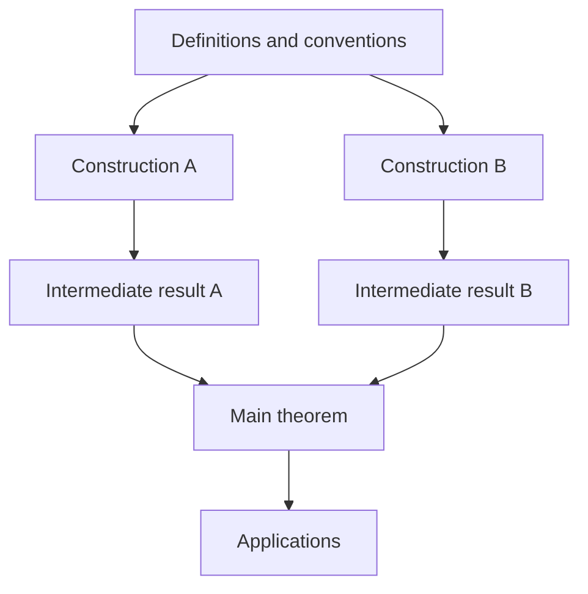

# Writing and expanding mathematical study notes

[Guide index](README.md)

These are the author's requirements for drafting, substantially rewriting, and expanding study notes. They govern the note's organization, depth, and treatment of supporting theories. Use the [style reference](style-reference.md) for language and notation, and [Paper writing and revision](paper-revision.md) for a wording-only edit. PreTeXt implementation is covered in the repository's [notes guide](https://github.com/vegetablefj/homepage/blob/main/NOTES.md).

## Establish the task

Infer what is already clear from the request and conversation. Ask only about missing information that materially changes the result; continue independent work.

- Topic and material: [source files, references, or the question discussed].
- Reader: [assumed background and desired depth].
- Scope and preservation: [whole note or selected passage; all substantive source content or selected material].
- Permitted changes: [reorder, change notation, split or combine results, add proofs and examples].
- Deliverable: [editable source and format, or text only].

Prioritize mathematical correctness, faithful scope and attribution, clear exposition, then brevity. Reduce what the intended reader must reconstruct: definitions, maps, reductions, and dependencies. Develop the note around the questions the reader needs answered.

## Reshape the whole before polishing sentences

For new or substantially rewritten notes, use the overall order **Preface → main body → Appendix → References**. Plan these parts together before expanding chapters:

- **Preface:** begin with concrete mathematical objects, their relevant properties, and the questions that motivate their study. State the note's aim through this mathematics, using concise notation and formulas where they help. Include useful theorem statements, background, and literature with accurate, concise attribution. Explain the scope, level of detail, principal results, and organizing ideas. Identify the intended reader and prerequisites. Give the chapter route and dependencies, then discuss relevant adjacent topics, related notes, and further reading. Add a short statement about continuing revisions and a factual acknowledgment of AI assistance. Use the parts that apply to the note. A linear route usually needs only prose; branching chapters or converging arguments may benefit from a diagram. Adapt the [Preface template](#preface-template).
- **Main body:** develop the definitions, constructions, results, examples, and proofs in their mathematical order. Essential hypotheses and dependencies must be available where needed.
- **Appendix:** collect substantial technical complements, detailed comparisons, or alternative proofs that would interrupt the main reading route. Explain their connection to the body and provide links in both directions. Do not move essential definitions or hypotheses here merely to shorten a chapter.
- **References:** give the complete, consistent bibliography for cited material after the appendices. Connect each entry to its actual uses; make sources of borrowed viewpoints and arguments identifiable.

Further results and problems are optional. Their inclusion and length should follow the note's purpose, scope, and intended reader. Place further results primarily in the corresponding chapters, usually near their ends, as a few paragraphs or a short subsection. Give exact hypotheses and sources, and explain the connection to the chapter. Select material for its mathematical relevance; a recent date alone does not justify inclusion. Technical proofs may be summarized or cited under the rules below. Keep external theories within the declared scope.

Further problems may be collected at the end. Choose a short closing discussion, a section, or a separate chapter according to the nature of the note; a dedicated chapter is optional and belongs before the appendices. Organize it around precise questions, with concise accounts of known cases and remaining difficulties. Refer to the results in the corresponding chapters instead of repeating their full statements. Distinguish attributed conjectures from questions raised in the notes, and do not invent an open problem merely to accompany a known result. Check source versions and current status before calling a question open; an unsuccessful search is insufficient.

In the reader-facing contents, list each appendix, References, and any Index directly alongside the chapters. Omit an intermediate "Back Matter" heading or landing page. In PreTeXt source, retain the native `backmatter` container for these divisions; the display hierarchy is separate from the source structure. An optional index may follow the references.

For new notes or substantial rewriting, determine the main questions, dependency order, and background to assume or supply. Explain the need for an important construction; a worked example can precede its abstract definition. Related definitions or statements can share a numbered item with parts. Separate results when their hypotheses, roles, or proofs differ.

When several examples use the same argument, explain the common construction once and compare the varying hypotheses, objects, and conclusions concisely; a table may help. Distinguish a construction valid for general members from its extension to a whole family by specialization or another theorem. Give substantial conclusions a statement readers can locate and cite, with their exact range.

Authorized rewriting permits replacing poor exposition, reorganizing proofs, changing confusing notation after checking its uses, and adding explanatory lemmas. Preserve the requested mathematical content. For a whole-source rewrite that must retain everything, keep a compact working map: source location → destination → treatment. Cover definitions, results, arguments, examples, substantive remarks, and qualifications. Record splits, mergers, and notation changes; check omissions before delivery. Local expansion only needs a check of the affected passage and dependencies.

## Either invoke a supporting theory precisely or develop it fully

Treat the intended reader's background as known. Use standard notions from external theories directly when those theories are outside the note's scope. If a reminder helps, keep it brief and put it in a margin note. Invoking a theorem from another subject does not require a preliminary account of that subject's definitions. Retain the conventions and hypotheses needed for the actual application. Develop definitions belonging to the note's subject in the body. Define its own objects and constructions before using them, even when their surrounding theory is assumed. Give the defining map, sequence, triangle, or other data needed to identify the object, and distinguish it from related objects introduced earlier.

For supporting material that needs further treatment, choose one of the following approaches before introducing a sequence of definitions or preliminary results:

- **Use a black box.** State the exact result needed, its hypotheses, and any notation or nonstandard conventions needed to apply it. Give a precise source or a link to a complete treatment, verify the hypotheses in the present situation, and explain the conclusion obtained. A short explanation of its meaning or use may help; make the boundary of the assumed result explicit.
- **Develop the required part of the theory.** Give it a coherent treatment in a section, chapter, appendix, or separate note. Supply the definitions, constructions, exact results, and mathematical connections needed to reach the stated goal from the declared prerequisites. Choose proof detail by expository role: develop instructive arguments, and give accurate outlines or precise verified references for complex technical proofs. Identify further results assumed as black boxes. Completeness concerns the declared mathematical scope and explicit dependencies; choose a scope that can actually be completed.

Avoid introducing a few definitions and fragments of proof, then relying on undeclared theory to finish the argument. Deliver the promised level of explanation, making assumed results and externally cited proofs explicit. For a substantial detour, provide a separate place for the coherent treatment and a precise reference at the point of use. Keep the dependencies free of cycles.

Brief intuition, examples, and margin notes can explain a black box without presenting themselves as its proof. In a rewrite required to preserve the source's full content, retain its substantive arguments as well; a citation supplements those arguments rather than replacing them.

## Define objects and use stable language

Within the declared scope, seek broadly applicable definitions and results with justified hypotheses. Compare useful directions of generality instead of assuming there is one strongest formulation. Give a clear main version, valuable variants, and recognizable common cases, explaining the choice. Establish the additional argument needed for a broader statement; develop its supporting theory under the rule above. Generality should improve the treatment of the chosen questions, not extend the project indefinitely.

### Defining data and quantifiers

Check a definition's data, axioms, quantifiers, and variable ranges. When a definition concerning \(A\) uses \(B\), distinguish internally:

- An existence property of \(A\): \(P(A)\iff\exists B\,R(A,B)\).
- Specified structure: the object is \((A,B)\), with \(R(A,B)\).
- A parameter \(B\) fixed by the surrounding conventions, on which the definition depends.
- An auxiliary choice, witness, or representative \(B\), whose role must be stated.

Separate existence from choosing a witness, uniqueness, and a canonical choice. Distinguish “some admissible \(B\)” from “every admissible \(B\)”, checking existence where needed to avoid a vacuous inference. Choosing a witness alone does not establish independence. If a construction depends only on \(A\), justify that claim; otherwise retain its dependence on \(B\). Morphisms and equivalences must respect specified structure in the adopted sense.

Apply this check to authoritative sources too, reading the ambient category and global conventions before interpreting an omitted \(B\). In finished prose, encode the correct data and quantifiers in natural standard definitions. Once they are clear, avoid repeating the distinction in explanatory prose. Keep comparisons that affect a construction, hypothesis, or conclusion; a concrete example may explain the difference better than another warning about choices or canonicity. Report a material unresolved ambiguity for review, with its source location, rather than silently choosing an interpretation or alleging an error.

### Conventions, notation, and prose

Specify the base field or ring, finiteness, variance, composition order, normalization, and size when relevant. Global conventions need not be repeated. Compare mathematical conditions before unifying terminology or notation. Explain differences that affect meaning or use, and give the hypotheses under which formulations agree. Preserve different notions even when sources share a name, and check errata. Put short comparisons near their first use, often in a margin note, and give longer discussions a complete place.

Define local symbols nearby and collect shared conventions briefly. Keep names stable within their scope; compatible conventions across related notes help, but different contexts need not share one universal symbol. A cross-note reference should identify the exact result, its required assumptions and conventions, any needed translation, and a link to its full treatment. Internal links should likewise point to the actual statement, construction, or proof promised by the surrounding sentence. When definitions or notation change, check affected statements, proofs, formulas, references, and dependent notes. Preserve valid IDs, macros, and links unless their revision is part of the task.

An index is optional. Include one when the length, range of topics, or alternative terminology makes it useful for lookup. A focused note may be served well by its contents, cross-references, and search. If an index is included, link significant terms, alternative names, and useful notation to their definitions or main discussions. Use it to locate content, not to repeat explanations or add definitions of assumed background. Retain useful existing entries and check their destinations when the text changes.

Write index entries in lower case, preserving proper names, acronyms, and mathematical notation: `primitive cohomology`, `Tate twist`, `Bridgeland stability condition`, `K3 surface`. Use the same capitalization as in ordinary prose.

Use concise, idiomatic chapter and section titles. For topic headings, prefer omitting an initial "The" when the shorter wording is natural and preserves the meaning. Judge particular constructions and theorem names individually; keep necessary articles and the intended singular or plural. Follow the [heading guidance](style-reference.md#mathematical-typography-and-source-formatting) and check titles in the contents together.

Develop one mathematical point per paragraph in connected sentences. Prefer existing accurate terms to synonyms chosen for variety. Keep modifiers next to their objects; repeat a symbol when a pronoun is ambiguous. Use “respectively” only for an ordered correspondence. Distinguish indices from indexed elements, inclusion from strict inclusion, and equality from isomorphism.

Check which object bears each property: a representative, class, family, image, quotient, action, or lattice. Write “classification of stable objects” when the objects are stable; “stable classification” changes the claim. Do not introduce “canonical”, “natural”, “unique”, or “maximal” without a precise meaning and justification.

Use “We use Proposition 3” instead of “The key ingredient is to leverage Proposition 3”. Avoid empty emphasis, invented noun clusters, and engineering metaphors; retain genuine technical terms. Integrate formulas into punctuated sentences and display long relations. Choose theorem environments by mathematical role; avoid invented parenthetical theorem names. Use recognized names and attribution where appropriate. Apply the detailed word preferences contextually, never by blind substitution.

## Make proofs informative and checkable

Develop representative constructions and proofs central to the learning goal in detail. State routine implications briefly. Complex or technical proofs may be summarized or cited according to their role in the exposition. Mark an outline as such, give its main steps and inputs, and identify omitted technical parts with a verified source for the full argument. Keep exact hypotheses and explain how the result is used. Check the deductions connecting the cited inputs: an outline still requires a valid implication at each step. Attribute only conclusions supplied by the cited result, and justify any further inference. Weaker hypotheses, stronger conclusions, and new assertions require their own justification or a verified applicable proof. For example, replacing “finite-dimensional” by “arbitrary” in a claim that \(V\to V^{**}\) is an isomorphism is not a language edit.

For long proofs, state intermediate claims with exact hypotheses and conclusions, then explain why they suffice before proving them. Construct important maps with sources and targets before asserting naturality or invertibility. Show a short inverse construction or calculation when it explains how the objects or formulas are connected. Specify its domain of validity and separate what it proves from any existence or extension result still supplied by a citation. When shrinking, changing base, or replacing an object, justify the operation, identify preserved hypotheses, and return to the original goal. Establish independence of choices by an appropriate equality or comparison; when comparison maps are used, specify them and check the required compatibility. Keep characterization, uniqueness, existence, and verification logically distinct.

Locate where consequential assumptions are used. Check well-definedness, implication directions, and relevant exceptional cases. Select examples and counterexamples that explain definitions or hypotheses; retain alternative proofs when they reveal different mechanisms. If a route fails, examine the precise obstruction or a counterexample rather than restating the desired conclusion.

Replace “The map is well-defined, clearly” by a verification. For a homomorphism \(f:A\to B\) of abelian groups and subgroups \(N\subseteq A\), \(M\subseteq B\) with \(f(N)\subseteq M\): “If \(x-x'\in N\), then \(f(x)-f(x')\in M\), so \(f(x)+M\) depends only on \(x+N\).”

## Compare and integrate sources

Actively survey and integrate multiple reliable sources for each substantial topic. Use established textbooks, specialist monographs, author notes, original articles, and maintained references according to their strengths. Assess mathematical relevance, precision, availability of arguments, versions, and corrections. Choose an organizing reference when helpful, but seek complementary treatments, broader or sharper formulations, alternative proofs, explanations, and independent checks. Authority and repeated agreement do not replace evidence; several sources may repeat the same argument or mistake. Add sources for a mathematical contribution, not a quota. Once the declared scope is covered and material differences are resolved or explicitly identified, continue the writing rather than gathering references indefinitely.

Read the relevant passages, including global conventions, before claiming verification. For substantial integration, keep a concise working map of concepts or claims, source versions and locators, assumptions, relationships between arguments, the adopted formulation, and unresolved differences. Extend an existing preservation map rather than duplicating records. Organize the exposition around mathematical questions and dependencies; synthesize the sources' contributions rather than presenting successive summaries. Bring consequential comparisons into the reading text; the working map itself need not be published.

Actively check key source statements and the arguments actually used for hidden assumptions, gaps, and possible counterexamples; source disagreement is not the only trigger. Investigate concerns through the proof, relevant cases, and independent evidence. Distinguish a harmless convention difference, a typographical error, an omitted argument, a false assertion, and an unresolved conflict. A compressed step may need expansion for this reader without being an error in the source. Before alleging a defect, check the version, surrounding conventions, and errata. Record the exact location and claim, supporting reasoning or a counterexample, any established repair, and the effect on dependent results. Correct established defects transparently and trace their downstream consequences. In a full-content rewrite, preserve the original claim's place in the correspondence and explain its correction; do not silently discard it or reproduce it as valid. Keep uncertain criticism explicitly unresolved and narrowly scoped.

Select important viewpoints and integrate them in fresh language, preserving qualifications and attribution. Cite a result, motivation, reduction, or proof strategy where used; give verified locators, and use “see also” for supplementary sources. Distinguish the source author's explanation, later developments, and this note's interpretation. Check current status before calling a historical question open; unsuccessful lookup establishes neither novelty nor priority. Unavailable evidence remains identified as unverified.

For exceptionally recent results or work with substantial AI involvement, cautious attribution is appropriate while substantial verification is still pending: “The authors claim that ...” or “The following result is claimed in [source].” Match this wording to the available mathematical evidence and scrutiny. A brief qualification at the statement usually suffices. Make conclusions that depend on such a claim conditional, and revisit the wording when its status becomes clearer.

Use consistent alphabetic author-year labels such as `AB26`, disambiguating collisions. Use actual citation links and bibliography entries, not typed bracketed labels. Preserve existing citation keys, distinguish editions and publication versions, and verify metadata before updating it. Never invent a locator or bibliographical field. A source describing an isomorphism class need not provide the coordinates used here.

## Add explanations at their point of need

Use footnotes and margin notes actively for short calculations, local proof details, notation translations, assumptions, intuition, examples, and source comments. Anchor each to its passage; readable displayed formulas and references are welcome. Essential hypotheses, constructions, estimates, and logical steps remain in the body. Long supplements belong in remarks, lemmas, subsections, or appendices, with nearby links.

When conversation reveals a misunderstanding, check it against definitions and sources, then insert the reusable explanation at the affected passage. Update dependencies if a convention or claim changes. Integrate the explanation into the note's prose. Diagrams and interactive examples should resolve a concrete question. The surrounding mathematical discussion can supply their text explanation; add a separate explanation only when needed. Demonstrations do not replace general proofs.

## Review the actual result

Check coverage and dependencies, mathematical claims and source comparisons, notation, links, and any index, then English and presentation. Verify that supporting theories are usable black boxes or completed treatments within their declared scope. Inspect the draft and diff for missing conditions, unsupported generalizations, altered attribution, unresolved conflicts hidden by unified wording, broken references, and remaining reading obstacles. Trace changes to affected dependents, fix findings, and recheck affected passages without repeating unrelated work.

Distinguish established proofs, conditional results, computations, conjectures, and gaps. Model agreement and successful builds do not certify mathematics. Report only checks actually performed. Correct established errors within scope and disclose substantive changes; otherwise identify the exact unresolved claim and its effect. Deliver the complete requested unit and its source, keeping working records and routine checklists out of reading text.

## Preface template

Use this template as an outline of the content and its order. Adapt the sentences and paragraph divisions to the actual mathematics. Replace the bracketed fields with concise text, verified citations, and working links. State the scope, prerequisites, organization, and sources directly. Keep only sentences that describe the actual contents.

- Open with the objects under study, concrete properties or constructions, and the questions they raise. Explain why they are worth studying through a mathematical connection, consequence, or application. Let these observations establish the note's overall aim before describing its organization.
- Use familiar mathematical notation for objects, conditions, invariants, and short relations. For a smooth complex cubic fourfold \(X\), for example, write \(h^{3,1}(X)=1\). Use prose to explain the significance of the relation rather than restating it at greater length. Introduce the notation needed at this point and keep formulas part of grammatical sentences. The balance of formulas and prose should follow the mathematics.
- The preface may contain theorem statements, including motivating results, central comparisons, and principal conclusions. Give the relevant hypotheses and conclusions, with attribution and a link to the proof or source. Use such statements where they clarify the mathematical purpose or organization. The main-result sentence below can become a theorem block, or be omitted when there is no single main theorem.
- Place the useful history and literature around this mathematical account. Credit the relevant authors accurately and concisely, including independent contributions where appropriate. Add historical claims only when supported by sources.
- Omit the adjacent-topic paragraph when no suitable related note or reference is available. The reference paragraph can reuse the main sources; it does not require additional sources.
- Give one reading route unless an alternative helps. Use section references for a shorter note. Explain conventions when they affect the mathematics or its interpretation. Omit routine interface commentary about what an index locates or which nodes are clickable. Let the chapter route explain the map's mathematical content.

### Preface

Let [objects with the necessary hypotheses]. [Concrete properties or constructions, using mathematical notation where helpful.] These lead to [specific question or comparison]. These notes study [precise mathematical goal].

[Brief account of the relevant results and their development, with sources and concise attribution.]

These notes cover [scope] and assume familiarity with [prerequisites]. The main result is [statement with essential hypotheses and a link]. We give the main constructions and arguments in detail. Some longer technical proofs are outlined or cited from the literature; the results used here are stated with their hypotheses.

We organize the material around [main idea and how it connects the parts].

The chapters follow [route, with links and important dependencies]. The appendices contain [supporting material].

For [adjacent topic], see [related note or reference and its connection to these notes].

For further reading, [references and the topics for which each is useful].

I plan to keep updating these notes to correct errors, improve explanations, and add useful material. Corrections, questions, and suggestions are welcome.

AI tools assisted with [tasks actually performed] in preparing these notes.

### Optional dependency diagram

Add a structure map after the chapter route and before related reading when it helps explain the dependencies. A linear route usually needs only prose. Use short chapter titles for a reading map, and intermediate statements for a proof map. Show the main branches and where they meet; check each arrow against the actual text. Distinguish mathematical dependencies from suggested reading order.

Use solid arrows for the main dependencies. Dashed arrows may distinguish secondary uses, such as an input needed in only one later section. Keep their meaning consistent within the map. An indirect dependency through other chapters may still be essential; an additional arrow is useful only if it conveys something the existing path does not. The chapter-route prose can explain these relations. Omit routine legends and explanations of links; add a short label only when needed to resolve an ambiguity.

In this example, two arguments meet at a main theorem. Replace the labels and arrows with the actual dependencies. Use a tree only when the dependencies form a tree.

Use precise, established mathematical labels. Shorten chapter titles while keeping the construction, result, or relation identifiable.

Center the map and keep its text readable at narrow widths. Align a main linear branch when this makes the graph easier to follow; other graphs may need a different layout. Minimize crossings and make joins unambiguous. Preserve the mathematical dependencies when adjusting the layout.

When the output supports it, make chapter nodes direct links to their chapters. Keep accessible descriptions and keyboard navigation, and verify the links in the built page. The repository's [notes guide](https://github.com/vegetablefj/homepage/blob/main/NOTES.md#chapter-and-proof-diagrams) gives the PreTeXt source formats, rendering choices, and checks.
